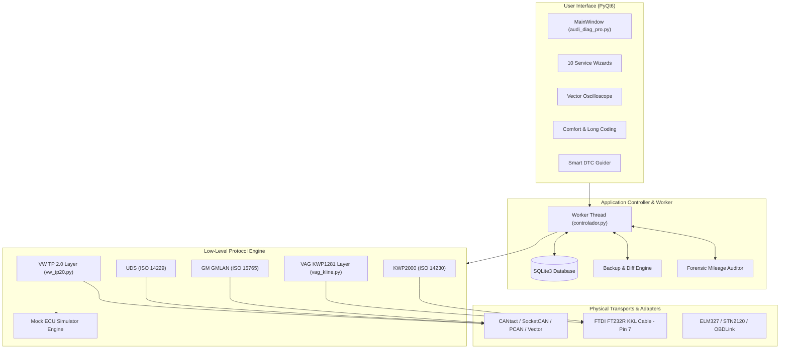

# OmniDiag (AudiDiag Pro Suite) 🚗⚡

[](https://www.python.org/)
[](https://riverbankcomputing.com/software/pyqt/)
[](https://www.sqlite.org/)
[](LICENSE)
[](#supported-hardware--transports)
[](#protocol-architecture)

> **Languages:** [English](README.md) | [Español](README_ES.md)

**OmniDiag** is an open-source, modular automotive diagnostic, live telemetry, and ECU coding suite engineered for **VAG (Audi, Volkswagen, SEAT, Škoda)** and **General Motors (Opel)** vehicles. 

Built with **Python** and **PyQt6**, OmniDiag implements native low-level communication protocols (**VW TP 2.0**, **KWP1281 / K-Line Pin 7**, **UDS / ISO 14229**, and **GMLAN / ISO 15765**) providing dealer-level diagnostic capabilities, guided service wizards, real-time vector telemetry, component actuator tests, and forensic mileage auditing without relying on expensive proprietary diagnostic tools.

---

## 📑 Table of Contents
1. [Key Features](#-key-features)
2. [Supported Vehicles & Modules](#-supported-vehicles--modules)
3. [Technology Stack](#-technology-stack)
4. [Architecture & Protocol Engine](#-architecture--protocol-engine)
5. [Service Wizards & Maintenance](#-service-wizards--maintenance)
6. [Supported Hardware & Transports](#-supported-hardware--transports)
7. [Installation & Quick Start](#-installation--quick-start)
8. [Testing & Verification](#-testing--verification)
9. [Project Layout](#-project-layout)
10. [Roadmap](#-roadmap)
11. [License](#-license)

---

## 🌟 Key Features

* **Dealer-Level Auto-Scan & DTC Diagnosis:**
  * Reads and clears fault codes across all installed ECUs with live technical priority rating (1: Critical, 2: Workshop, 3: Safety, 5: Comfort).
  * Distinguishes **Active / Static** vs. **Sporadic / Intermittent** faults (using KWP1281 Bit 7 and UDS fault status bits).
  * Built-in offline database with **10,000+ official VAG & SAE DTC definitions**.
* **Smart DTC Guider & Guided Inspection Sheets (`DialogoFichaDTC`):**
  * Double-click any fault code to open an interactive technical datasheet.
  * Displays physical component location, DIN electrical wiring prefixes (e.g., `N` for solenoid valves, `G` for sensors, `J` for relays/ECUs, `Q` for glow plugs), fuse box locations, and step-by-step multimeter testing procedures.
* **10 Specialized Service & Maintenance Wizards:**
  * One-click procedures for electronic parking brake service, oil and LongLife inspection reset, DPF emergency regeneration, common rail injector calibration, BEM battery coding, ABS hydraulic bleeding, ZF gearbox adaptation reset, G85 steering angle calibration, intake manifold flap adaptation, and MMI green menu activation.
* **Volkswagen PQ24 (K-Line Pin 7) Dedicated Engine:**
  * Pure native implementation of **KWP1281** with 5-baud hardware initialization (`0x00` address, 7-O-1 byte reflection handshake).
  * Live adaptation channels (Auto-Lock @ 15 km/h, Auto-Unlock on key removal, DWA siren acoustic chirp, selective door unlocking, TRW power steering assist curve adjustment).
  * Live bidirectional actuator testing (N75 boost pressure valve, N18 EGR valve, J52 glow plug relay, instrument cluster needle sweep, V113/V68 HVAC blend flaps, ABS hydraulic pump V39).
* **Forensic Mileage Audit (`auditoria_kilometraje.py`):**
  * Multi-ECU cross-examination to detect odometer fraud and rollbacks by comparing odometer data across Engine (Bosch EDC16/EDC17), Instrument Cluster, ABS/ESP Bosch 8.0, Transmission ZF 6HP, Airbag, and DPF ash mileage counters.
* **Vector Telemetry Oscilloscope & CAN Dyno:**
  * Real-time high-refresh-rate vector plotting widget (`QPainter`) with smooth curves and anti-aliasing.
  * Integrated acceleration performance chronometer (0-60 km/h, 0-100 km/h, trap times).
* **Differential Backup Manager (`DialogoDiffBackups`):**
  * Automatically creates bit-level snapshots of ECU configurations before any adaptation or coding write.
  * Visual side-by-side diff highlighting modified bytes and bits with safe rollback capabilities.
* **Automated HTML Report Generation:**
  * Exports formatted, print-ready technical workshop diagnostic reports with VIN, vehicle identification, full module scan results, and sensor timestamps.
* **Complete Offline Simulation Mode (MOCK):**
  * Full software-in-the-loop mock ECU simulation for UI design, testing, and development on any PC without physical car hardware connected.

---

## 🚗 Supported Vehicles & Modules

### 1. Audi A6 C6 (Platform 4F / C6 · 2004–2011) & VAG CAN TP 2.0
* **Bus Architecture:** CAN High-Speed (500 kbps), CAN Comfort & Infotainment (100 kbps fault-tolerant) via Gateway J533.
* **Protocols:** VW TP 2.0, KWP2000 over TP2.0, UDS (ISO 14229).
* **Target ECUs:**
  * `01 - Engine`: 2.7 / 3.0 V6 TDI (Bosch EDC16CP34 / EDC17), 2.0 TDI (EDC16), 2.4 / 3.2 FSI, 4.2 V8.
  * `02 - Transmission`: ZF 6HP19 / 6HP26 Tiptronic & Multitronic VL300.
  * `03 - ABS / ESP`: Bosch 8.0 / 8.2 ESP with G85 steering angle sensor and wheel speed odometry.
  * `08 - HVAC`: Climatronic Dual / Quad-zone.
  * `09 - Central Electrics`: Bordnetz J519.
  * `15 - Airbag`: SRS Airbag system.
  * `17 - Instrument Cluster`: Kombiinstrument VDO / Magneti Marelli.
  * `19 - Gateway`: J533 CAN Gateway & BEM Battery Energy Manager (J644).
  * `46 - Comfort Module`: BCM J393.
  * `53 - Parking Brake`: EPB Electric Parking Brake (TRW).
  * `07 / 5F - MMI Infotainment`: MMI 2G High / MMI 3G.

### 2. Volkswagen Polo 9N3 (Platform PQ24 · 2005–2009) & VAG K-Line
* **Bus Architecture:** K-Line (Pin 7, ISO 9141-2 / ISO 14230) @ 9600 / 10400 bauds.
* **Protocols:** Native VAG **KWP1281** & KWP2000 with 5-baud address handshake.
* **Target ECUs:**
  * `01 - Engine`: 1.9 TDI PD (Bosch EDC15P+ / EDC16U1), 1.4 TDI PD, 1.2 / 1.4 16V MPI.
  * `03 - ABS / Brakes`: Continental Teves / Bosch ABS 8.0.
  * `08 - Climate`: Climatic / Climatronic HVAC.
  * `09 - Central Electrics`: Bordnetz 6Q0 / 6Q1.
  * `15 - Airbag`: Airbag VW5 / VW6.
  * `17 - Instrument Cluster`: VDO / Motometer Instrument Cluster.
  * `44 - Power Steering`: TRW Electrohydraulic Power Steering (EHPS).
  * `46 - Comfort / BCM`: Central locking, anti-theft DWA, power windows.
  * `56 - Radio`: RCD 200 with DSP cabin equalization.

### 3. Opel Corsa D (Platform S68 · 2006–2014) & GM GMLAN
* **Bus Architecture:** High Speed CAN (500 kbps), Low Speed Single-Wire GMLAN (33.3 kbps).
* **Protocols:** ISO 15765-4 CAN, KWP2000 GM.
* **Target ECUs:** Engine ECM (1.3 CDTI Z13DTH / Z13DTJ, 1.2 / 1.4 Twinport Z12XEP / Z14XEP), Body Control Module (BCM), Instrument Panel (IPC), Electric Power Steering (EPS).

### 4. Universal OBD2 / EOBD Mode
* Standard ISO 15765-4 (CAN 11-bit/29-bit 500k/250k), ISO 14230-4 (KWP2000), ISO 9141-2.
* Live SAE PIDs (RPM, Speed, Coolant Temp, MAP, MAF, Fuel Trim, Spark Advance, O2 Sensors).
* Universal Mode $01 (Live Data), Mode $03 (Read DTCs), Mode $04 (Clear DTCs), Mode $09 (VIN / CALID).

---

## 🛠 Technology Stack

| Domain | Technology / Library | Purpose |
| :--- | :--- | :--- |
| **Language** | Python 3.10 / 3.11 / 3.12 / 3.14 | Core asynchronous application logic |
| **User Interface** | PyQt6 (`QtWidgets`, `QtCore`, `QtGui`) | Desktop application GUI with responsive dark theme |
| **Database** | SQLite3 (`sqlite3`) | Local offline storage for 10K+ DTCs, backups, telemetry, and sessions |
| **CAN Bus Interface** | `python-can` (>= 4.2.0) | High-speed CAN frame communication, SocketCAN, CANtact, PCAN |
| **Serial / K-Line** | `pyserial` (>= 3.5) | FTDI serial communication, 5-baud bit-banging, K-Line Pin 7 |
| **Plotting & Dyno** | Custom `QPainter` Vector Widget | Smooth 60 FPS oscilloscope without heavy webview overhead |
| **Testing** | `unittest` & Custom Test Suites | Automated regression verification across all models and protocols |

---

## 📐 Architecture & Protocol Engine



---

## 🔧 Service Wizards & Maintenance

The **Maintenance & Wizards** tab provides 10 pre-engineered service routines:

| Wizard | Target ECU | Protocol | Description |
| :--- | :--- | :--- | :--- |
| **EPB Pad Replacement** | Freno Mano (53) | TP2.0 / KWP | Open brake calipers (Group 007), Close/Calibrate (Group 006), 3-cycle functional test (Group 010). |
| **SRI Service Reset** | Cuadro (17) | KWP / Adaptation | 1-Click Oil interval reset (Ch 02 = 0) and full LongLife inspection setup (Ch 40-45, 30,000 km / 730 days). |
| **DPF Forced Regen** | Motor (01) | KWP2000 (Login 10016) | Pre-flight safety checks (ECT > 70°C, Fuel > 25%), Basic Setting Ch 099 soot burn-off cycle. |
| **Common Rail Injectors** | Motor (01) | KWP2000 (Ch 72-77) | Calibration offset analysis (-45 ms needle wear vs +15 ms nozzle clogging) on V6 TDI piezoinjectors. |
| **BEM Battery Coding** | Gateway (19) | KWP2000 (Ch 04) | Generates and writes official 24-character OEM BEM codes (Part No + Vendor + Serial) for AGM/Wet batteries. |
| **ABS Hydraulic Bleeding** | ABS (03) | TP2.0 Basic Setting | Guides the 3-step hydraulic brake fluid bleeding process cycling the ABS return pump V39 and solenoid valves. |
| **ZF 6HP Transmission Reset**| Transmisión (02) | KWP2000 (Ch 000) | Resets clutch filling adaptation pressures, fast-fill times, and prepares the ECU for the adaptation drive. |
| **G85 Steering Angle Sensor** | ABS (03) | Security Access 40168 | Centers steering angle sensor G85 to 0.0° and clears ESP malfunction lights after wheel alignment. |
| **Intake Flap V157 Adaptation**| Motor (01) | Basic Setting (Ch 121) | Calibrates stop-points for swirl flap servomotors V157 and V275 across Bank 1 and Bank 2. |
| **MMI Green Engineering Menu** | Infotainment (07/5F)| Adaptation (Ch 08 = 1) | Enables the hidden diagnostic and engineering green screen menu on MMI 2G High and 3G systems. |

---

## 🔌 Supported Hardware & Transports

1. **USB K-Line / KKL Cables:**
   * Standard blue VAG KKL 409.1 cables featuring genuine **FTDI FT232R** or CH340 USB-to-UART bridge.
   * Direct connection to Pin 7 (K-Line), Pin 4/5 (GND), and Pin 16 (+12V Battery).
2. **Dedicated CAN Bus Hardware:**
   * CANtact, CANable (candleLight / slcan firmware).
   * PEAK PCAN-USB, Vector CANcase/CANcard, ValueCAN.
   * Linux SocketCAN native network interfaces (`can0`, `vcan0`).
3. **Serial OBD2 Adapters:**
   * Scantool OBDLink SX / EX (STN11xx / STN21xx chipsets).
   * Quality ELM327 USB / Bluetooth interfaces (firmware v1.4b+).
4. **PC Simulation Mode (MOCK):**
   * Select `SIMULADO (Audi A6 C6)`, `SIMULADO K-Line (VW Polo 9N3)`, or `SIMULADO (Opel Corsa D)`.
   * Complete hardware-independent sandbox with emulated response delays, DTC registries, and real-time sensor fluctuation.

---

## 🚀 Installation & Quick Start

### Prerequisites
* **Operating System:** Windows 10/11 or modern Linux distribution (Ubuntu 20.04+, Debian 11+, Arch).
* **Python:** Version 3.10, 3.11, 3.12, or 3.14.

### 1. Clone Repository & Install Dependencies
```bash
# Clone the repository
git clone https://github.com/SrAndrew5/OmniDiag.git
cd OmniDiag

# Create and activate virtual environment (optional but recommended)
python -m venv venv
# On Windows:
.\venv\Scripts\activate
# On Linux:
source venv/bin/activate

# Install required dependencies
pip install -r requirements.txt
```

### 2. Launch OmniDiag
```bash
python audi_diag_pro.py
```

### 3. Usage
1. Connect your OBD2 cable to the PC and the vehicle's OBD-II diagnostic port.
2. Select your vehicle from the top dropdown:
   * **Audi A6 C6 (CAN TP2.0)**
   * **VW Polo 9N3 (K-Line)**
   * **Opel Corsa D (OBD2/CAN)**
   * **Simulated Modes** (for testing without a car)
3. Select your serial COM port or CAN interface and click **Conectar**.
4. Use the tabs to run full Auto-Scans, modify comfort options, view the real-time oscilloscope, or run service wizards.

---

## 🧪 Testing & Verification

OmniDiag includes comprehensive unit and integration test suites:

```bash
# Run Polo K-Line and Integration Suite (18 tests)
python -m unittest tests/test_polo_main_integration.py tests/test_kline_suite.py

# Run Service Wizards and V11/V12 Regression Suites
python tests/test_v11_suite.py
python tests/test_v12_suite.py
```

---

## 📂 Project Layout

```text
OmniDiag/
├── main.py                      # Clean application entry point launcher
├── audi_diag_pro.py             # Main PyQt6 entry point and graphical user interface
├── auditoria_kilometraje.py     # Multi-ECU forensic mileage auditor
├── requirements.txt             # Python dependencies
├── README.md                    # Project documentation (English)
├── README_ES.md                 # Project documentation (Spanish)
│
├── tests/                       # Automated unit and integration test suites
├── obd/                         # Low-level protocol and hardware communications
│   ├── vag_kline.py             # Native VAG KWP1281 K-Line (Pin 7) engine
│   ├── vw_tp20.py               # VW Transport Protocol 2.0 (TP2.0) implementation
│   ├── tp20_can.py              # TP2.0 channel multiplexer and socket driver
│   ├── vag_protocol.py          # High-level VAG diagnostic services
│   ├── vag_service_wizards.py   # 10 automated maintenance service routines
│   ├── vag_dtc_smart_guide.py   # Guided DTC inspection sheets & DIN heuristics
│   ├── audi_database.py         # CAN identifiers, address maps, and ECU catalog
│   ├── obd_manager.py           # Serial and CAN port discovery and setup
│   └── can_sniffer.py           # Real-time CAN bus traffic capture and filtering
│
├── ui/                          # GUI components, dialogs, and widgets
│   ├── controlador.py           # Background QThread worker and hardware abstraction
│   ├── osciloscopio.py          # Vector real-time telemetry plotting widget
│   ├── dialogo_ficha_dtc.py     # Interactive technical fault inspection sheet
│   ├── dialogo_confort_wizard.py# Visual long coding and comfort toggle dialog
│   ├── dialogo_diff_backups.py  # Visual ECU backup diff and rollback manager
│   ├── dialogo_gateway_list.py  # Gateway J533 installed module list editor
│   └── dialogo_polo_kline.py    # Dedicated K-Line testbench dialog
│
├── gestion/                     # Persistent storage and database managers
│   └── database_manager.py      # SQLite3 backend (DTC catalog, backups, telemetry)
│
├── herramientas/                # Utility scripts and database generators
│   └── generar_catalogo_dtc.py  # Generator script for 10K+ DTC SQLite definitions
│
└── datos/                       # Local data, backups, and reports
    ├── diagnostico.db           # SQLite3 database file
    ├── backups/                 # Timestamped JSON backups of ECU codings
    └── reportes/                # Exported HTML diagnostic reports
```

---

## 🗺 Roadmap

### ✅ Completed & Active Support
- [x] **Audi A6 C6 (2004–2011)**: Full CAN Bus support (TP 2.0 / KWP2000 / UDS) across all ECUs, 10 service wizards, smart DTC sheets, and forensic mileage auditing.
- [x] **Opel Corsa D 2007 (Bus)**: Full CAN Bus support (High-Speed CAN & Low-Speed Single-Wire GMLAN) for engine, BCM, IPC, and EPS.
- [x] **Volkswagen Polo 9N3 2007 (K-Line)**: Full K-Line support (Native KWP1281 / Pin 7 @ 10,400 baud) across all 8 modules, real adaptation channels, live actuator tests, and TDI telemetry.
- [x] **Core Diagnostics Engine**: Vector telemetry oscilloscope, CAN dyno chronometer, differential backup manager with rollback, and automated HTML reporting.

### 🎯 Immediate Next Milestone
- [ ] **Fiat Group (K-Line)**: Complete K-Line support for Fiat, Alfa Romeo, and Lancia (KWP2000 / ISO 9141-2 / Fiatecuscan protocol via Pins 1, 7, and 9) for engine, ABS, airbag, and electric steering.

### 🚀 Upcoming Vehicle Expansions
- [ ] **Fiat Group (CAN Bus)**: Full CAN Bus support for Fiat/Alfa/Lancia (CAN High Speed 500k & B-CAN 50k body network, proxy alignment).
- [ ] **Stellantis Group**: Full diagnostic support for Peugeot, Citroën, DS, and modern Opel platforms (PSA CAN2004 / CAN2010 architectures).
- [ ] **BMW Group**: Diagnostic and coding integration (K-Line DS2, D-CAN, K-CAN, and ENET).
- [ ] **Japanese Manufacturers**: Dedicated support for Toyota, Honda, and Nissan (ISO 14230, CAN, and proprietary protocols).
- [ ] **Ford Group**: Multi-bus support (HS-CAN, MS-CAN, and J1850 PWM protocols).
- [ ] **Further Global Brands**: Progressive expansion across remaining automotive manufacturers.

### 📱 Long-Term / Low Priority
- [ ] **Bluetooth / Wireless Connectivity**: Bluetooth Low Energy (BLE) and wireless dongle integration (deferred to prioritize wired diagnostic depth and protocol coverage).

---

## 📄 License & Intellectual Property

Copyright © 2026 **SrAndrew**. All Rights Reserved.

This project is released under a **Proprietary & Portfolio View-Only License**:
* **Permitted:** Public source code inspection, technical evaluation, code review, and academic/portfolio assessment for recruitment purposes.
* **Prohibited:** Any unauthorized compiling, running, modification, copying, distribution, or commercial exploitation without prior written consent from the author.

See the [LICENSE](LICENSE) file for complete legal terms.

---

*Developed with passion for automotive engineering, low-level reverse engineering, and embedded software.*
