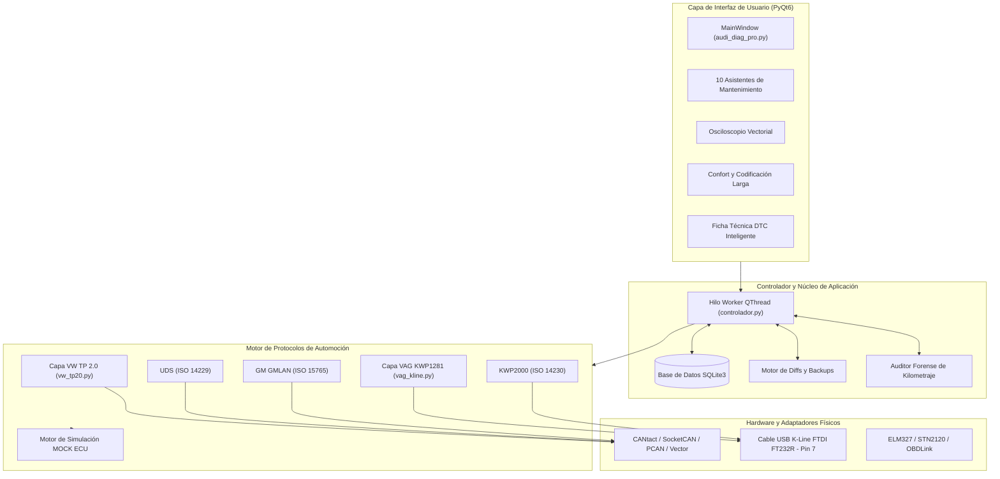

# OmniDiag (AudiDiag Pro Suite) 🚗⚡

[](https://www.python.org/)
[](https://riverbankcomputing.com/software/pyqt/)
[](https://www.sqlite.org/)
[](LICENSE)
[](#hardware-y-adaptadores-compatibles)
[](#arquitectura-y-motor-de-protocolos)

> **Idiomas:** [English](README.md) | [Español](README_ES.md)

**OmniDiag** es una plataforma open-source y modular de diagnosis automotriz avanzada, telemetría en tiempo real y codificación de centralitas (ECUs) desarrollada para vehículos del **Grupo VAG (Audi, Volkswagen, SEAT, Škoda)** y **General Motors (Opel)**.

Desarrollada en **Python** y **PyQt6**, OmniDiag implementa directamente los protocolos de comunicación nativos de bajo nivel (**VW TP 2.0**, **KWP1281 / Línea K Pin 7**, **UDS / ISO 14229** y **GMLAN / ISO 15765**), ofreciendo capacidades de nivel de concesionario: asistentes guiados de mantenimiento, osciloscopio vectorial en vivo, test bidireccional de actuadores, auditoría forense de kilometraje y adaptación de confort sin requerir costosas máquinas propietarias.

---

## 📑 Tabla de Contenidos
1. [Características Principales](#-características-principales)
2. [Vehículos y Módulos Soportados](#-vehículos-y-módulos-soportados)
3. [Stack Tecnológico](#-stack-tecnológico)
4. [Arquitectura y Motor de Protocolos](#-arquitectura-y-motor-de-protocolos)
5. [Asistentes de Servicio y Mantenimiento](#-asistentes-de-servicio-y-mantenimiento)
6. [Hardware y Adaptadores Compatibles](#-hardware-y-adaptadores-compatibles)
7. [Instalación y Puesta en Marcha](#-instalación-y-puesta-en-marcha)
8. [Batería de Pruebas y Tests](#-batería-de-pruebas-y-tests)
9. [Estructura del Proyecto](#-estructura-del-proyecto)
10. [Hoja de Ruta (Roadmap)](#-hoja-de-ruta-roadmap)
11. [Licencia](#-licencia)

---

## 🌟 Características Principales

* **Auto-Scan Completo y Diagnóstico de Averías (DTCs):**
  * Lectura y borrado de códigos de fallo en todas las centralitas instaladas con clasificación técnica de prioridad (1: Crítica, 2: Taller, 3: Seguridad, 5: Confort).
  * Diferenciación inequívoca entre fallos **Activos / Estáticos** vs. **Esporádicos / Históricos** (evaluando el Bit 7 en KWP1281 y bits de estado UDS).
  * Catálogo local integrado con **más de 10.000 descripciones oficiales VAG y SAE**.
* **Ficha Técnica Inteligente de Averías (`DialogoFichaDTC`):**
  * Doble clic en cualquier avería para abrir un informe técnico interactivo con ubicación física del componente en el vano motor o habitáculo.
  * Identificación de prefijos eléctricos oficiales según normativa DIN (ej. `N` para electroválvulas, `G` para sensores, `J` para relés/centralitas, `Q` para bujías de precalentamiento).
  * Pasos guiados de comprobación con polímetro y ubicación de fusibles.
* **10 Asistentes de Mantenimiento y Servicio Especializados:**
  * Procedimientos de 1 solo clic para cambio de pastillas traseras EPB, reseteo de intervalos de servicio LongLife, regeneración forzada de DPF, calibración de inyectores Common Rail, codificación de batería nueva BEM, purga hidráulica de frenos ABS, reseteo de caja ZF 6HP, calibración de sensor de giro de volante G85, adaptación de chapaletas de admisión V157 y activación del menú verde de ingeniería en MMI.
* **Motor Nativo Volkswagen PQ24 (Línea K / Pin 7):**
  * Implementación pura y desde cero del protocolo **KWP1281** con inicialización rápida a 5 baudios (`0x00`, handshake de paridad 7-O-1 con byte invertido).
  * Canales reales de adaptación (Auto-Lock a 15 km/h, Auto-Unlock al extraer la llave, pitido acústico DWA, apertura selectiva, dureza de dirección electrohidráulica TRW Normal/GTI).
  * Test bidireccional de actuadores en vivo (válvula turbo N75, EGR N18, relé de calentadores J52, barrido de agujas de cuadro, compuertas V113/V68 de clima, electrobomba ABS V39).
* **Auditoría Forense de Kilometraje Real (`auditoria_kilometraje.py`):**
  * Cruce de datos multi-centralita para detectar fraudes y afeitados de odómetro, contrastando los km del Cuadro con la memoria interna de Motor (Bosch EDC16/EDC17), odometría de ruedas en ABS/ESP Bosch 8.0, Transmisión ZF 6HP, Airbag y contadores de regeneración del filtro DPF.
* **Osciloscopio Vectorial de Telemetría y Cronómetro CAN:**
  * Renderizado continuo y fluido a 60 FPS mediante `QPainter` vectorial con curvas suavizadas antialiasing.
  * Cronómetro integrado de aceleración y rendimiento por bus CAN (0-60 km/h, 0-100 km/h y tiempos de respuesta).
* **Gestor Diferencial de Copias de Seguridad (`DialogoDiffBackups`):**
  * Creación automática de snapshots bit a bit de la codificación antes de cualquier escritura.
  * Comparador visual que resalta en color los bytes y bits alterados, con función de restauración segura (rollback).
* **Generador Automático de Informes en HTML:**
  * Exporta informes técnicos formateados y listos para imprimir con el VIN, identificación del vehículo, resultado del escaneo y registros de sensores.
* **Modo de Simulación Offline Completo (MOCK):**
  * Entorno simulado para pruebas y desarrollo en PC sin necesidad de tener el vehículo ni cables conectados físicamente.

---

## 🚗 Vehículos y Módulos Soportados

### 1. Audi A6 C6 (Plataforma 4F / C6 · 2004–2011) & VAG CAN TP 2.0
* **Red del Vehículo:** Bus CAN de Alta Velocidad (500 kbps), CAN Confort e Infotainment (100 kbps tolerante a fallos) mediante Pasarela Gateway J533.
* **Protocolos:** VW TP 2.0, KWP2000 sobre TP2.0, UDS (ISO 14229).
* **Centralitas Soportadas:**
  * `01 - Motor`: 2.7 / 3.0 V6 TDI (Bosch EDC16CP34 / EDC17), 2.0 TDI (EDC16), 2.4 / 3.2 FSI, 4.2 V8.
  * `02 - Transmisión`: ZF 6HP19 / 6HP26 Tiptronic y Multitronic VL300.
  * `03 - ABS / ESP`: Bosch 8.0 / 8.2 ESP con sensor de ángulo G85 y odometría de ruedas.
  * `08 - Climatización`: Climatronic Bizona / Cuatrizona.
  * `09 - Red de a Bordo`: Bordnetz J519.
  * `15 - Airbag`: Sistema de retención SRS Airbag.
  * `17 - Cuadro de Instrumentos`: Kombiinstrument VDO / Magneti Marelli.
  * `19 - Pasarela Gateway`: J533 CAN Gateway y Gestor Energético de Batería BEM (J644).
  * `46 - Módulo de Confort`: BCM J393.
  * `53 - Freno de Estacionamiento`: Freno de mano eléctrico EPB (TRW).
  * `07 / 5F - MMI Infotainment`: MMI 2G High / MMI 3G.

### 2. Volkswagen Polo 9N3 (Plataforma PQ24 · 2005–2009) & VAG Línea K
* **Red del Vehículo:** Línea K serie (Pin 7 del conector OBD, ISO 9141-2 / ISO 14230) a 9600 / 10400 baudios.
* **Protocolos:** VAG **KWP1281** nativo y KWP2000 con handshake a 5 baudios.
* **Centralitas Soportadas:**
  * `01 - Motor`: 1.9 TDI Bomba-Inyector (Bosch EDC15P+ / EDC16U1), 1.4 TDI PD, 1.2 / 1.4 16V Gasolina.
  * `03 - ABS / Frenos`: Continental Teves / Bosch ABS 8.0.
  * `08 - Climatización`: Climatic / Climatronic.
  * `09 - Central Eléctrica`: Bordnetz 6Q0 / 6Q1.
  * `15 - Airbag`: Airbag VW5 / VW6.
  * `17 - Cuadro de Instrumentos`: VDO / Motometer.
  * `44 - Dirección Asistida`: Dirección electrohidráulica TRW (EHPS).
  * `46 - Confort / Cierre`: Cierre centralizado, alarma DWA, elevalunas confort.
  * `56 - Radio`: RCD 200 con ecualización de habitáculo DSP.

### 3. Opel Corsa D (Plataforma S68 · 2006–2014) & GM GMLAN
* **Red del Vehículo:** CAN Alta Velocidad (500 kbps), CAN Baja Velocidad Unifilar GMLAN (33.3 kbps).
* **Protocolos:** ISO 15765-4 CAN, KWP2000 GM.
* **Centralitas Soportadas:** Motor ECM (1.3 CDTI Z13DTH / Z13DTJ, 1.2 / 1.4 Twinport Z12XEP / Z14XEP), BCM (Carrocería), IPC (Cuadro), EPS (Dirección Eléctrica).

### 4. Modo Universal OBD2 / EOBD
* Estándar ISO 15765-4 (CAN 11-bit/29-bit 500k/250k), ISO 14230-4 (KWP2000), ISO 9141-2.
* Lectura de PIDs SAE estándar en vivo (RPM, velocidad, temperatura refrigerante, MAF, MAP, corrección de combustible, avance de encendido, sondas Lambda).
* Modos universales $01 (Datos en vivo), $03 (Leer averías), $04 (Borrar averías), $09 (Información VIN / CALID).

---

## 🛠 Stack Tecnológico

| Área | Tecnología / Librería | Propósito |
| :--- | :--- | :--- |
| **Lenguaje** | Python 3.10 / 3.11 / 3.12 / 3.14 | Lógica central de control asíncrono y decodificación de protocolos |
| **Interfaz Gráfica** | PyQt6 (`QtWidgets`, `QtCore`, `QtGui`) | Entorno visual de escritorio con estilo moderno y paleta oscura |
| **Base de Datos** | SQLite3 (`sqlite3`) | Almacenamiento local de más de 10K fallos DTC, copias de seguridad y sesiones |
| **Interfaz CAN Bus** | `python-can` (>= 4.2.0) | Gestión de tramas CAN a alta velocidad, SocketCAN, CANtact, PCAN |
| **Comunicaciones Serie / K-Line** | `pyserial` (>= 3.5) | Control de puerto serie FTDI, bit-banging a 5 baudios, Línea K Pin 7 |
| **Gráficas y Telemetría** | Widget Vectorial `QPainter` | Osciloscopio fluido a 60 FPS sin sobrecarga de motores web |
| **Batería de Tests** | `unittest` & Suites Personalizadas | Validación automática de regresiones en todos los protocolos y coches |

---

## 📐 Arquitectura y Motor de Protocolos



---

## 🔧 Asistentes de Servicio y Mantenimiento

La pestaña **Mantenimiento y Asistentes** incluye 10 rutinas profesionales pre-programadas:

| Asistente | Módulo Objetivo | Protocolo | Descripción Técnica |
| :--- | :--- | :--- | :--- |
| **Cambio Pastillas EPB** | Freno Mano (53) | TP2.0 / KWP | Retracción de motores (Grupo 007), Cierre y calibración de holgura (Grupo 006), Test dinámico de 3 ciclos (Grupo 010). |
| **Reseteo de Servicio (SRI)** | Cuadro (17) | KWP / Adaptación | Reseteo de aceite en 1 clic (Canal 02 = 0) y configuración integral LongLife (Canales 40 a 45, 30.000 km / 730 días). |
| **Regeneración Forzada DPF** | Motor (01) | KWP2000 (Login 10016) | Comprobación de condiciones previas (Temp > 70°C, Tanque > 25%), ciclo de quemado de hollín en Ajuste Básico Canal 099. |
| **Calibración Inyectores** | Motor (01) | KWP2000 (Canales 72-77)| Diagnóstico de tiempos de compensación a 300, 600 y 1000 bar (-45 ms desgaste aguja vs +15 ms tobera obstruida). |
| **Codificación Batería BEM** | Gateway (19) | KWP2000 (Canal 04) | Generación y escritura de cadenas oficiales de 24 caracteres BEM (Referencia OEM + Fabricante + Nº Serie) para AGM/Plomo. |
| **Purga Hidráulica Frenos ABS**| ABS (03) | TP2.0 Ajuste Básico | Asistente de 3 pasos que comanda la electrobomba de retorno V39 y cicla las electroválvulas del bloque hidráulico. |
| **Reseteo Caja Cambios ZF** | Transmisión (02) | KWP2000 (Canal 000) | Restablecimiento de presiones de llenado de embragues y tiempos de llenado rápido de la caja Tiptronic 6HP. |
| **Sensor de Giro Volante G85** | ABS (03) | Security Access 40168 | Calibración del punto cero (0.0°) del sensor G85 y apagado del testigo de control de tracción ESP. |
| **Chapaletas Admisión V157** | Motor (01) | Ajuste Básico (Ch 121) | Calibración de topes mecánicos de servomotores de turbulencia V157 y V275 en ambas bancadas del V6 TDI. |
| **Menú Verde de Ingeniería MMI**| Infotainment (07/5F)| Adaptación (Canal 08 = 1)| Habilita el menú oculto de desarrollador e ingeniería en sistemas MMI 2G High y MMI 3G. |

---

## 🔌 Hardware y Adaptadores Compatibles

1. **Cables USB K-Line / KKL:**
   * Cables estándar VAG KKL 409.1 con chip **FTDI FT232R** o CH340.
   * Conexión directa a Pin 7 (Línea K), Pin 4/5 (Masa/Chasis) y Pin 16 (+12V Batería).
2. **Interfaces CAN Bus Dedicadas:**
   * CANtact, CANable (firmware candleLight o slcan).
   * PEAK PCAN-USB, Vector CANcase/CANcard, ValueCAN.
   * Interfaces de red nativas SocketCAN en Linux (`can0`, `vcan0`).
3. **Adaptadores Serie OBD2:**
   * Scantool OBDLink SX / EX (chipsets STN11xx / STN21xx).
   * Interfaces ELM327 USB / Bluetooth de calidad comprobada (firmware v1.4b en adelante).
4. **Modo de Simulación en PC (MOCK):**
   * Selecciona `SIMULADO (Audi A6 C6)`, `SIMULADO K-Line (VW Polo 9N3)` o `SIMULADO (Opel Corsa D)`.
   * Permite probar la aplicación completa, las pantallas y los flujos sin necesidad de vehículo real.

---

## 🚀 Instalación y Puesta en Marcha

### Requisitos Previos
* **Sistema Operativo:** Windows 10/11 o distribución moderna de Linux (Ubuntu 20.04+, Debian 11+, Arch).
* **Python:** Versión 3.10, 3.11, 3.12 o 3.14.

### 1. Clonar el Repositorio e Instalar Dependencias
```bash
# Clonar el repositorio
git clone https://github.com/SrAndrew5/OmniDiag.git
cd OmniDiag

# Crear y activar entorno virtual (opcional pero recomendado)
python -m venv venv
# En Windows:
.\venv\Scripts\activate
# En Linux:
source venv/bin/activate

# Instalar dependencias necesarias
pip install -r requirements.txt
```

### 2. Ejecutar OmniDiag
```bash
python audi_diag_pro.py
```

### 3. Conexión y Uso
1. Conecta el cable al puerto USB del ordenador y al conector de diagnosis OBD-II del vehículo.
2. Selecciona el coche en el desplegable superior:
   * **Audi A6 C6 (CAN TP2.0)**
   * **VW Polo 9N3 (K-Line)**
   * **Opel Corsa D (OBD2/CAN)**
   * **Modos Simulados** (para pruebas en ordenador)
3. Escoge el puerto COM serie o interfaz CAN correspondiente y pulsa **Conectar**.
4. Navega por las pestañas para realizar escaneos completos de averías, probar actuadores, registrar telemetría o utilizar los asistentes de taller.

---

## 🧪 Batería de Pruebas y Tests

OmniDiag dispone de suites de pruebas unitarias y de integración automáticas:

```bash
# Ejecutar suite de integración Polo 9N3 y K-Line (18 tests)
python -m unittest tests/test_polo_main_integration.py tests/test_kline_suite.py

# Ejecutar validaciones de asistentes de servicio y suites V11 / V12
python tests/test_v11_suite.py
python tests/test_v12_suite.py
```

---

## 📂 Estructura del Proyecto

```text
OmniDiag/
├── main.py                      # Lanzador limpio de la aplicación
├── audi_diag_pro.py             # Punto de entrada principal e interfaz gráfica PyQt6
├── auditoria_kilometraje.py     # Auditor forense de kilometraje real multi-ECU
├── requirements.txt             # Dependencias del proyecto en Python
├── README.md                    # Documentación del proyecto (Inglés)
├── README_ES.md                 # Documentación del proyecto (Español)
│
├── tests/                       # Suites automáticas de pruebas unitarias y de integración
├── obd/                         # Protocolos de bajo nivel y drivers de comunicación
│   ├── vag_kline.py             # Motor nativo VAG KWP1281 para Línea K (Pin 7)
│   ├── vw_tp20.py               # Capa de transporte VW Transport Protocol 2.0 (TP2.0)
│   ├── tp20_can.py              # Multiplexor de canales TP2.0 y sockets CAN
│   ├── vag_protocol.py          # Servicios de diagnosis VAG de alto nivel
│   ├── vag_service_wizards.py   # 10 rutinas de mantenimiento y asistentes guiados
│   ├── vag_dtc_smart_guide.py   # Base inteligente de componentes y heurística DIN
│   ├── audi_database.py         # Mapa de IDs CAN, direcciones y catálogo de ECUs
│   ├── obd_manager.py           # Detección y gestión de puertos serie y CAN
│   └── can_sniffer.py           # Captura y filtrado de tráfico en el bus CAN
│
├── ui/                          # Componentes de interfaz gráfica, widgets y diálogos
│   ├── controlador.py           # Hilo QThread worker y capa de abstracción de hardware
│   ├── osciloscopio.py          # Widget vectorial para osciloscopio de telemetría en vivo
│   ├── dialogo_ficha_dtc.py     # Modal interactivo con la ficha técnica de la avería
│   ├── dialogo_confort_wizard.py# Asistente visual para codificación y opciones de confort
│   ├── dialogo_diff_backups.py  # Comparador visual de snapshots y copias de seguridad
│   ├── dialogo_gateway_list.py  # Editor de lista de montaje del Gateway J533
│   └── dialogo_polo_kline.py    # Banco de pruebas dedicado para Línea K
│
├── gestion/                     # Persistencia de datos y base de datos
│   └── database_manager.py      # Gestor SQLite3 (DTCs, histórico, telemetría y copias)
│
├── herramientas/                # Scripts de utilidad y generadores de catálogo
│   └── generar_catalogo_dtc.py  # Script generador de la base con más de 10.000 DTCs
│
└── datos/                       # Archivos locales de datos, copias e informes
    ├── diagnostico.db           # Base de datos local SQLite3
    ├── backups/                 # Copias de seguridad JSON de configuraciones
    └── reportes/                # Informes diagnósticos generados en HTML
```

---

## 🗺 Hoja de Ruta (Roadmap)

### ✅ Soporte Completo Actual
- [x] **Audi A6 C6 (2004–2011)**: Soporte completo por Bus CAN (TP 2.0 / KWP2000 / UDS) en todas las centralitas, 10 asistentes de mantenimiento, fichas técnicas DTC y auditoría de kilometraje real.
- [x] **Opel Corsa D 2007 (Bus)**: Soporte completo por Bus CAN (High-Speed CAN y GMLAN de baja velocidad) para Motor, BCM, Cuadro (IPC) y Dirección (EPS).
- [x] **Volkswagen Polo 9N3 2007 (K-Line)**: Soporte completo por Línea K (KWP1281 nativo / Pin 7 a 10.400 baudios) en sus 8 módulos, canales reales de adaptación, test de actuadores y telemetría TDI.
- [x] **Núcleo de Diagnosis Avanzado**: Osciloscopio vectorial de telemetría, cronómetro de aceleración CAN, gestor diferencial de copias de seguridad con rollback e informes en HTML.

### 🎯 Próximo Hito Inmediato
- [ ] **Grupo Fiat (Línea K)**: Soporte completo por Línea K para Fiat, Alfa Romeo y Lancia (protocolos KWP2000 / ISO 9141-2 / Fiatecuscan mediante Pines 1, 7 y 9) para Motor, ABS, Airbag y Dirección Asistida.

### 🚀 Próximas Fases de Expansión
- [ ] **Grupo Fiat (Bus CAN)**: Soporte completo por Bus CAN para Fiat/Alfa/Lancia (CAN Alta Velocidad 500k y red de carrocería B-CAN a 50k, alineamiento proxy).
- [ ] **Grupo Stellantis**: Soporte integral para plataformas Peugeot, Citroën, DS y Opel moderno (arquitecturas PSA CAN2004 / CAN2010).
- [ ] **Grupo BMW**: Integración de diagnosis y codificación (Línea K DS2, D-CAN, K-CAN y ENET).
- [ ] **Marcas Japonesas**: Soporte especializado para Toyota, Honda y Nissan (ISO 14230, CAN y protocolos propietarios de fabricante).
- [ ] **Grupo Ford**: Soporte multi-red (protocolos HS-CAN, MS-CAN y J1850 PWM).
- [ ] **Resto de Fabricantes Globales**: Ampliación progresiva para el resto de marcas del mercado automotriz.

### 📱 Futuro a Largo Plazo (Baja Prioridad)
- [ ] **Conectividad Bluetooth / Inalámbrica**: Integración de adaptadores BLE y dongles inalámbricos (pospuesta a segundo plano para priorizar la profundidad técnica por cable y la cobertura de marcas).

---

## 📄 Licencia y Propiedad Intelectual

Copyright © 2026 **SrAndrew**. Todos los derechos reservados.

Este proyecto se publica bajo una **Licencia Propietaria de Solo Visualización para Portfolio y CV**:
* **Permitido:** La inspección y lectura pública del código fuente con fines de contratación, evaluación técnica, revisión de código y valoración académica/portfolio.
* **Prohibido:** Cualquier compilación, ejecución, modificación, copia, redistribución o explotación comercial no autorizada sin el consentimiento previo por escrito del autor.

Consulta el archivo [LICENSE](LICENSE) para ver los términos legales completos.

---

*Desarrollado con pasión por la ingeniería del automóvil, la ingeniería inversa de protocolos y el desarrollo de software embebido.*
